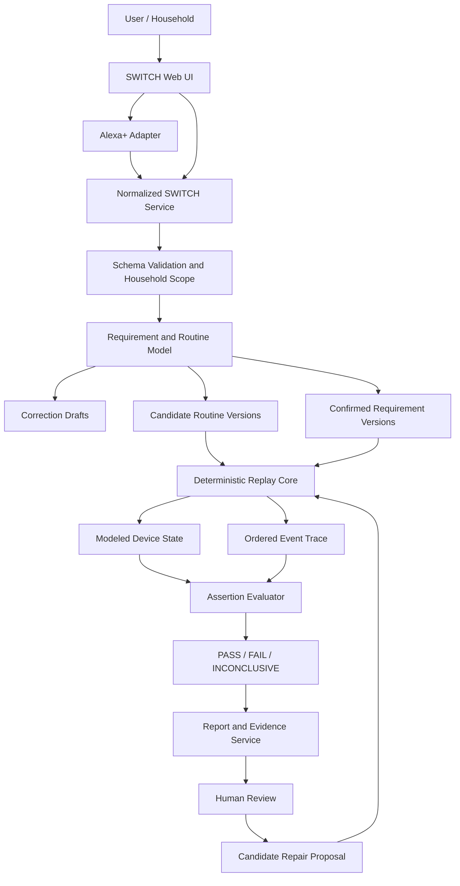
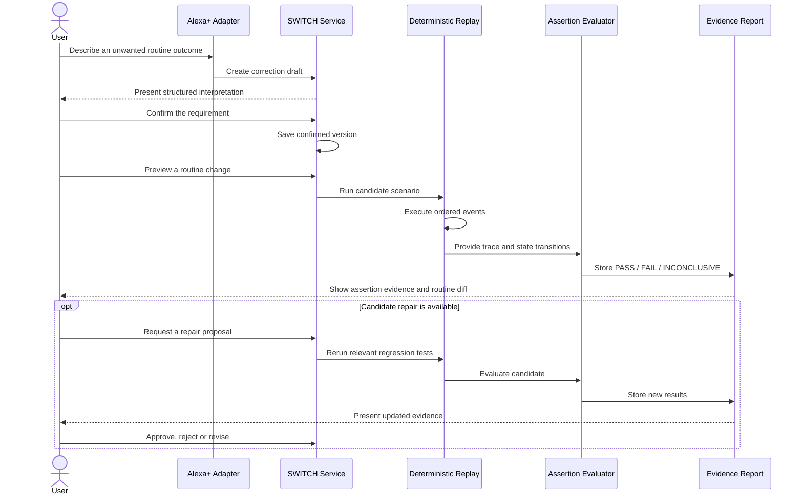

# 🔀 SWITCH

## A Fix Today Should Not Become a Failure Tomorrow.

<p align="center">
  <b>BUILD • SHIP • SHAPE — AMAZON DEVELOPER HACKATHON</b>
  <br/>
  <b>Alexa / Alexa+ Track</b>
  <br/><br/>
  <sub>Smart-Home Routine Verification • Regression Testing • Human-Controlled Automation</sub>
</p>

<p align="center">
  
  
  
  
  
  
</p>

---

# 🏆 Competition

## BUILD • SHIP • SHAPE — AMAZON DEVELOPER HACKATHON

**Platform:** Devpost

**Track:** Alexa / Alexa+

**Project:** SWITCH

**Category:** Smart-home automation reliability and routine verification

**Team:** TWOPOINTERS.

---

# 🚨 The Problem

## "Alexa, don't turn off the hallway light while someone is there."

Imagine coming home late at night.

You have taught Alexa your Goodnight routine. It turns off the lights, locks the doors, and prepares your home for the night. It works perfectly.

Then, a few days later, someone edits the routine.

A condition disappears. A new action is added. Another routine begins interacting with it.

You say the exact same words.

**But your home behaves differently.**

The problem is not necessarily that Alexa misunderstood the original command. The routine itself may have changed in a way that violates what you intended.

Today, a user can correct an unexpected behavior without having a reliable way to preserve that correction as a reusable regression test for later routine edits.

The engineering challenge is to preserve household intent across changes.

- A correction may fix one incident without becoming a durable requirement.
- Related routines may interact in unexpected ways.
- A proposed fix may introduce another regression.
- An AI explanation does not prove that the behavior is correct.
- A passing simulation does not certify the physical home.
- Users need to understand what changed and approve a proposed repair.

The fundamental question is:

> **How do we make sure a smart-home routine change does not silently undo a correction the household already made?**

---

# 💡 Our Solution

**SWITCH is a smart-home routine verification layer designed around one principle:**

> **A correction should become a testable requirement, not just another conversation.**

SWITCH helps an Alexa+-oriented household turn an explicitly confirmed correction into a contextual, versioned requirement that can be replayed when a related routine changes.

The system is designed to combine:

- 🏠 Household, room and device context
- 🗣️ Natural-language correction capture
- ✅ Explicit confirmation of interpreted intent
- 📚 Saved, versioned household requirements
- 🔄 Routine-change comparison
- ⏱️ Deterministic scenario replay
- 🔍 Event traces and assertion evidence
- 🧪 Regression testing
- 🛠️ Constrained candidate repair suggestions
- 🔁 Re-running tests after a proposed repair
- 👤 Human review and approval
- 📋 Reproducible test reports
- 🔌 Clear integration provenance for live, imported and simulated data

The key distinction is that **AI may interpret a correction or suggest a repair, but the deterministic verification engine owns the test result.**

---

# 🎯 Core Principle

SWITCH does not treat a plausible AI answer as proof that a routine is correct.

Instead, it follows a repeatable verification workflow:

```text
USER CORRECTION
       ↓
INTERPRET INTENT
       ↓
CLARIFY AMBIGUITIES
       ↓
USER CONFIRMATION
       ↓
VERSIONED REQUIREMENT
       ↓
ROUTINE CHANGE
       ↓
DETERMINISTIC REPLAY
       ↓
ASSERTION EVALUATION
       ↓
PASS / FAIL / INCONCLUSIVE
       ↓
TRACE + EVIDENCE
       ↓
PROPOSED REPAIR
       ↓
RE-RUN REGRESSION SUITE
       ↓
HUMAN REVIEW
```

The interpretation layer proposes meaning.

The requirement layer preserves confirmed intent.

The replay engine executes a modeled scenario.

The evaluator determines whether the assertions passed.

The user decides whether a proposed change should be approved.

---

# 🏠 The Canonical SWITCH Scenario

Consider a household with a hallway light and an occupancy sensor.

## Before the change

The Goodnight routine contains an occupancy guard.

```text
ROUTINE: GOODNIGHT

IF:
    Goodnight is triggered
    AND hallway occupancy is false

THEN:
    Turn hallway light OFF
```

The household explicitly confirms this requirement:

> The hallway light must not be turned off by Goodnight while hallway occupancy is detected.

SWITCH saves the confirmed requirement with its scope, conditions, expected behavior and version.

## A routine edit introduces a regression

Someone edits Goodnight and removes the occupancy condition.

```text
BEFORE

Goodnight
    ↓
Check occupancy
    ↓
Occupancy = false?
    ↓
Turn light OFF


AFTER EDIT

Goodnight
    ↓
Turn light OFF
```

The edited routine no longer preserves the original expectation.

## SWITCH replays the scenario

```text
SCENARIO INPUT

Goodnight triggered = true
Hallway occupancy = true
Hallway light = ON
          ↓
EXECUTE CANDIDATE ROUTINE
          ↓
ACTUAL ACTION: LIGHT OFF
          ↓
COMPARE WITH CONFIRMED REQUIREMENT
          ↓
FAIL
          ↓
SHOW REQUIREMENT + EVENT TRACE
          ↓
PROPOSE RESTORING OCCUPANCY GUARD
          ↓
RE-RUN TESTS
          ↓
USER REVIEWS CANDIDATE
```

The failure is supported by the modeled event trace and the violated assertion, not merely by an AI-generated explanation.

This is the core SWITCH experience: **remember what the household corrected, then test whether future changes preserve it.**

---

# 🧠 What Makes SWITCH Different?

Most routine troubleshooting focuses on understanding or correcting the behavior that just occurred.

SWITCH focuses on whether that correction survives the next change.

| Conventional troubleshooting | SWITCH's proposed approach |
|---|---|
| Explain a routine conflict | Preserve the user's confirmed expectation |
| Fix the current behavior | Create a reusable regression requirement |
| Inspect the current routine | Compare candidate versions |
| Show a suggested fix | Show the proposed diff and rerun evidence |
| Trust a plausible explanation | Evaluate explicit assertions against a trace |
| Report a binary success | Distinguish PASS, FAIL and INCONCLUSIVE |
| Apply a change immediately | Require explicit human approval |

The differentiator is not simply detecting a conflict.

It is **preserving intent across routine changes and making the verification evidence inspectable.**

---

# 🛠️ Core Product Modules

## 1. 🏠 Home Overview

The home overview provides the context needed to understand a routine.

Designed capabilities include:

- Household and room selection
- Device states and capabilities
- Active routines
- Requirements potentially affected by a routine change
- Latest replay results
- Recent activity
- A Run Regression entry point
- Integration status

The house visualization and the accompanying panels should reflect the same underlying modeled state.

## 2. 🗣️ Correction Capture

A user describes an undesirable outcome in natural language.

Example:

```text
"Don't turn off the hallway light
while someone is there."
```

The interpretation layer proposes a structured requirement containing relevant entities, conditions, expected behavior and scope.

If the statement is ambiguous, SWITCH should ask for clarification instead of silently guessing.

An interpretation remains a draft until the user explicitly confirms it.

## 3. 📚 Saved Requirements

Confirmed corrections become inspectable, versioned requirements.

Each requirement is designed to retain:

- Requirement ID
- Original correction
- Household and device scope
- Preconditions
- Expected behavior
- Version
- Confirmation state
- Creation and update history
- Last replay result

Users should be able to review, edit, disable or retire requirements while preserving their history.

Unconfirmed drafts must never be treated as enforced requirements.

## 4. 🔄 Replay Lab

The Replay Lab makes the verification process understandable rather than hiding it behind a final status.

It is designed to display:

- Original and candidate routine versions
- The routine diff
- A deterministic simulated clock
- Ordered events
- Condition evaluation
- State transitions
- Assertion results
- Requirement IDs associated with failures
- Proposed repair
- Rerun controls

A user should be able to inspect exactly which modeled event caused an expectation to fail.

## 5. 🔍 Deterministic Verification

The verification engine evaluates explicit assertions against a reproducible execution trace.

```text
LOAD CANDIDATE ROUTINE
          ↓
LOAD REQUIREMENT VERSIONS
          ↓
FREEZE SCENARIO INPUTS
          ↓
INITIALIZE MODELED STATE
          ↓
ORDER EVENTS DETERMINISTICALLY
          ↓
EXECUTE CONDITIONS AND ACTIONS
          ↓
RECORD STATE TRANSITIONS
          ↓
EVALUATE ASSERTIONS
          ↓
GENERATE TRACE-BACKED REPORT
```

### Result semantics

| Status | Meaning |
|---|---|
| PASS | All required assertions evaluated true for the modeled scenario and recorded versions. |
| FAIL | At least one evaluated assertion was violated, with evidence identifying the requirement and relevant trace. |
| INCONCLUSIVE | A necessary condition, capability, sensor state or modeled behavior could not be evaluated reliably. |

Unknown state must never silently become PASS.

A passing result applies only to the tested requirements, scenario and versions. It is not a guarantee that a physical home is safe.

## 6. 🛠️ Candidate Repair

When a requirement fails, SWITCH can optionally suggest a constrained candidate repair.

The intended workflow is:

```text
FAILED ASSERTION
       ↓
IDENTIFY RELEVANT CONDITION
       ↓
PROPOSE CANDIDATE DIFF
       ↓
VALIDATE THE CANDIDATE
       ↓
RERUN TARGETED TESTS
       ↓
RERUN RELEVANT REGRESSIONS
       ↓
SHOW NEW TRACE + RESULTS
       ↓
HUMAN REVIEW
```

A suggested repair is not a verified fix until the relevant tests have been rerun successfully.

Candidate changes are not automatically deployed to a live routine.

## 7. 📋 Reports

The reporting layer is designed to preserve enough information to reproduce and inspect a result.

A report can include:

- Replay run ID
- Scenario inputs
- Routine version
- Requirement versions
- Simulator version
- Assertion totals
- PASS / FAIL / INCONCLUSIVE results
- Event trace
- Expected and actual states
- Proposed routine diff
- Reviewer decision
- Integration mode and provenance

Reports should present evidence, not a blanket score claiming that the entire home is safe.

## 8. 🔌 Devices and Integrations

The integration experience distinguishes what data is available and where it came from.

```text
INTEGRATION STATUS

Source: SIMULATED / IMPORTED / CONNECTED
Routine provenance: Explicit
Supported capabilities: Explicit
Last health check: Where available
Permissions: According to the integration
```

A simulated routine must remain visibly simulated. A live connection should only be shown after a real, supported connection has been implemented and tested.

---

# 🏗️ System Architecture

SWITCH separates the Alexa+ interaction layer from the routine model, deterministic replay engine and assertion evaluator.



### Architectural boundaries

- The web UI presents household context, routine changes, traces and reports.
- The adapter translates supported inputs into the internal SWITCH contract.
- The normalized service validates schemas, versions and household scope.
- The requirement model preserves confirmed corrections.
- The replay core evaluates explicit, reproducible scenarios.
- The assertion evaluator owns the test result.
- The report service retains evidence.
- The optional AI layer proposes structured interpretations or candidate repairs.
- Human approval remains separate from deployment.

---

# 🔌 Alexa+ Integration Strategy

Alexa+ is the interaction and integration layer for the Alexa-oriented SWITCH experience. It does not replace the deterministic verification core.

The primary integration route must be selected according to the developer access and official requirements available for the hackathon.

```text
                 ALEXA+ INTERACTION
                         │
                         ▼
                 SUPPORTED ADAPTER
                         │
                         ▼
                SWITCH TOOL CONTRACT
                         │
                         ▼
               REQUIREMENT WORKFLOW
                         │
                         ▼
              DETERMINISTIC REPLAY
                         │
                         ▼
                TRACE-BACKED RESULT
```

Potential integration paths include:

- A supported MCP server using the required transport and protocol version.
- A supported Alexa+ Agent Skill.
- An in-app Alexa+-style simulation connected to the actual SWITCH workflow when live access is unavailable.

The supported route must be verified before claiming integration.

A simulated experience must be labelled **SIMULATED DEMO** and must invoke the real SWITCH application logic rather than displaying hardcoded results.

## Proposed Tool Contract

The adapter is designed around narrow, typed operations:

| Operation | Purpose |
|---|---|
| `switch_create_correction_draft` | Interpret a correction into a draft requirement. |
| `switch_get_requirement` | Retrieve a requirement and its history. |
| `switch_confirm_requirement` | Confirm a reviewed draft explicitly. |
| `switch_list_routines` | List supported routines and versions. |
| `switch_preview_routine_change` | Inspect a candidate diff and affected requirements. |
| `switch_run_replay` | Execute deterministic tests. |
| `switch_get_replay_report` | Retrieve assertion results and trace evidence. |
| `switch_propose_repair` | Create a constrained candidate diff. |
| `switch_record_review_decision` | Record an approve, reject or revise decision. |

These are proposed contract names; the repository should document which operations are actually implemented and exposed.

---

# 🔐 AI Boundaries, Security and Trust

SWITCH is designed around three separate responsibilities.

```text
AI INTERPRETATION
    │
    └── Propose structured intent or a candidate repair

DETERMINISTIC VERIFICATION
    │
    └── Evaluate assertions against modeled execution evidence

AUTHORIZED HUMAN
    │
    └── Review and approve or reject a candidate
```

The system should enforce the following principles:

- Validate structured AI outputs against explicit schemas.
- Ask for clarification when required information is missing.
- Require confirmation before activating a requirement.
- Keep household data within the correct scope.
- Validate routine and requirement versions.
- Reject unsupported operations and malformed inputs.
- Keep secrets out of source control.
- Avoid logging unnecessary sensitive household information.
- Treat unknown sensor states and unsupported capabilities as INCONCLUSIVE.
- Never infer PASS from generated explanatory text.
- Never deploy a candidate repair without the required human approval.

---

# 🧪 Testing and Evaluation

The verification engine should be evaluated using reproducible scenarios and recorded fixtures.

## Core Test Scenarios

| Scenario | Expected verification behavior |
|---|---|
| Occupancy guard preserved | PASS when all relevant assertions hold. |
| Occupancy guard removed | FAIL when the modeled light turns off despite detected occupancy. |
| Sensor state unknown | INCONCLUSIVE when the assertion cannot be evaluated reliably. |
| Ambiguous correction | Remain a draft or request clarification. |
| Unconfirmed requirement | Do not treat it as an active requirement. |
| Candidate repair proposed | Do not mark it verified until replay completes. |
| Repair satisfies the original requirement | PASS only if the relevant assertions actually pass. |
| Repair breaks another requirement | FAIL for the violated regression assertion. |
| Unsupported device capability | INCONCLUSIVE rather than silently passing. |
| Identical replay inputs | Reproduce the same modeled trace and result. |

## Evaluation Metrics

The project can be evaluated using:

- Regression catch rate
- False-pass and false-fail rates
- Reproducibility across identical inputs
- Natural-language interpretation accuracy
- Ambiguity and clarification rate
- Requirement-to-trace traceability
- Candidate repair validation rate
- User comprehension of reports

Measured values should be reported only after the corresponding experiments have actually been run.

---

# 🧭 End-to-End Workflow



---

# 🖥️ Product Experience

The planned product experience is organized around seven views.

```text
SWITCH
  │
  ├── 1. Home Overview
  │      Household, rooms, devices and recent replays
  │
  ├── 2. Why SWITCH
  │      Correction-to-regression explanation
  │
  ├── 3. Replay Lab
  │      Routine diff, clock, event trace and assertions
  │
  ├── 4. Saved Requirements
  │      Confirmed expectations, versions and history
  │
  ├── 5. Reports
  │      Reproducible results and reviewer decisions
  │
  ├── 6. Devices & Integrations
  │      Capabilities, provenance and connection status
  │
  └── 7. Settings
         Privacy, retention, accessibility and environment
```

The interface should make simulated versus connected behavior visible, preserve accessible state-driven UI, and ensure that the displayed replay timeline matches the underlying trace.

---

# 🛠️ Technology Stack

The final technology list should match the actual submitted repository.

## Frontend

- React / Next.js, according to the project configuration
- TypeScript, where configured
- Tailwind CSS and UI components, where configured
- Accessible, state-driven interaction patterns

## Backend and Verification

- SWITCH service and normalized API
- Versioned routine and requirement models
- Deterministic simulator
- Explicit event ordering
- Assertion evaluator
- Replay trace and report generation
- Persistence where implemented

## AI and Integration

- Structured natural-language interpretation
- Schema-validated candidate repair proposals
- Alexa+ adapter through the supported integration route
- Clearly labelled simulated fallback when required

## Testing

- Deterministic fixtures
- Regression scenarios
- Assertion-level tests
- Reproducibility checks
- Integration tests where available

> Do not add a technology badge or claim a service is integrated unless the code and submitted demo support that claim.

---

# 🚀 Getting Started

## Prerequisites

Install the tools required by the actual repository:

- Node.js and npm, if the frontend uses them
- The configured backend runtime
- Dependencies listed in the project manifests
- Any explicitly required environment services

## 1. Clone the Repository

```bash
git clone <https://github.com/rahulsharma767/SWITCH->
cd <YOUR_REPOSITORY_DIRECTORY>
```

## 2. Install Dependencies

For a Node.js frontend:

```bash
npm install
```

Install backend dependencies using the project's actual dependency manifest and setup instructions.

## 3. Configure the Environment

Create the required local environment file using the variable names documented in the repository.

```text
.env.local
```

Do not commit credentials, API keys, household data or production secrets.

## 4. Start the Application

Use the commands defined in the repository's scripts and backend entry points.

For a frontend that defines a development script:

```bash
npm run dev
```

Open the local URL printed by the development server.

## 5. Verify the Demo Mode

Confirm that the integration status accurately identifies whether the current experience is simulated, imported or live-connected.

Use the documented sample routine and scenario fixtures to reproduce the verification workflow.

> **Setup note:** Replace these general instructions with the repository's verified commands, required environment variables and exact local URLs before submitting.

---

# ▶️ Demo Workflow

Use the following scenario to demonstrate the core concept, provided each step is implemented in the submitted build.

```text
1. Open SWITCH
        ↓
2. Inspect the modeled household
        ↓
3. Open the Goodnight routine
        ↓
4. Enter the hallway occupancy correction
        ↓
5. Review and confirm the requirement
        ↓
6. Save the versioned requirement
        ↓
7. Introduce a candidate routine edit
        ↓
8. Remove the occupancy guard
        ↓
9. Run deterministic replay
        ↓
10. Inspect the failed assertion
        ↓
11. Open the event trace and routine diff
        ↓
12. Request a candidate repair
        ↓
13. Rerun the relevant regression suite
        ↓
14. Inspect the updated evidence
        ↓
15. Approve, reject or revise the candidate
```

The demo should show actual application behavior, not a sequence of prerecorded results presented as live verification.

---

# 🏅 What Makes SWITCH Worth Building?

The interesting problem is not whether AI can explain a smart-home routine.

It is whether a household's explicit expectations can survive changes to that routine.

SWITCH connects a user's correction to a persistent requirement, a reproducible scenario, an assertion-level result, and a human decision.

```text
CORRECT
   ↓
CONFIRM
   ↓
PRESERVE
   ↓
REPLAY
   ↓
VERIFY
   ↓
INSPECT
   ↓
APPROVE
```

That creates a practical engineering direction for smart-home reliability: make routine changes testable before treating them as trustworthy.

---

# 🎯 What's Next for SWITCH?

1. Complete the end-to-end correction, confirmation and persistence workflow.
2. Strengthen deterministic replay and assertion coverage.
3. Improve clarification for ambiguous natural-language requirements.
4. Add candidate routine diffs and constrained repair validation.
5. Complete the supported Alexa+ integration route and document its evidence.
6. Expand regression fixtures across interacting routines and device states.
7. Evaluate reproducibility, regression detection and false-pass behavior.
8. Improve report traceability, privacy controls and accessible review workflows.

The long-term direction is to make smart-home automation changes easier to inspect, reproduce, test and approve.

---

# ⚠️ Scope and Limitations

SWITCH must distinguish modeled behavior from physical-device behavior.

The master specification describes a prototype that models devices, routines, saved requirements and test results. A live Alexa account or physical-device connection must not be claimed until it has been implemented and tested.

A PASS means that the selected assertions passed for the recorded modeled scenarios and versions. It does not certify the physical home or guarantee that every possible routine interaction has been covered.

Likewise, an AI-generated repair is only a candidate until deterministic tests rerun successfully.

These boundaries are part of the trust model, not exceptions to it.

---

# 🔗 Project Links

- **GitHub Repository:** https://github.com/rahulsharma767/SWITCH-.
- **Working Demo:** https://switch-virid.vercel.app/#/home.
- **Demo Video:** https://youtu.be/skNt18zIUVg?si=OZla5FN2XvzavW7Y.
- **Devpost Submission:** https://devpost.com/software/switch-krhtvp.
---

<p align="center">
  <b>SWITCH</b>
  <br/><br/>
  <b>Remember the correction.</b>
  <br/>
  <b>Replay the scenario.</b>
  <br/>
  <b>Verify the change.</b>
  <br/><br/>
  <sub>Built for the Amazon Developer Hackathon — Alexa Track</sub>
</p>
